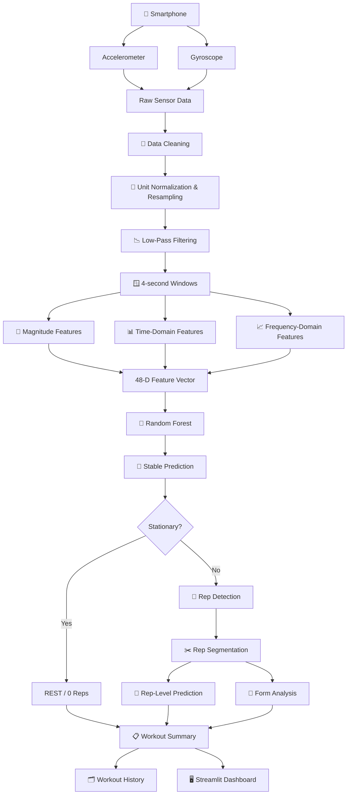
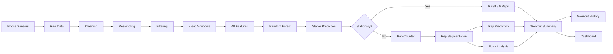

# 🏋️ AI Fitness Tracker
## End-to-End Smartphone IMU Exercise Recognition, Repetition Counting & Workout Analysis

<p align="center">
  <b>Turn smartphone motion into structured workout intelligence.</b><br>
  <sub>Sense → Process → Understand → Count → Analyze → Visualize</sub>
</p>

<p align="center">
  
  
  
  
  
</p>

---

# 🌟 Overview

**AI Fitness Tracker** is an end-to-end machine learning system that uses smartphone **accelerometer and gyroscope** signals to recognize exercises and generate workout analytics.

The project goes beyond a single classifier. It combines:

- Smartphone IMU sensing
- Signal cleaning and normalization
- Resampling and filtering
- Temporal windowing
- Magnitude features
- Time-domain features
- Frequency-domain features
- Random Forest classification
- Stable exercise prediction
- Stationary / REST detection
- Repetition counting
- Repetition segmentation
- Rep-level prediction
- Form anomaly analysis
- Workout summarization
- Workout history
- Interactive Streamlit dashboard
- Model evaluation and deployment benchmarking
- Smartphone domain-adaptation experiments

The final architecture is:

```text
Smartphone IMU
      ↓
Data Cleaning
      ↓
Resampling
      ↓
Signal Filtering
      ↓
4-second Windowing
      ↓
Feature Engineering
      ↓
48-Dimensional Feature Vector
      ↓
Random Forest Classifier
      ↓
Stable Exercise Prediction
      ↓
Stationary / REST Gate
      ↓
Rep Counting + Segmentation
      ↓
Rep Prediction + Form Analysis
      ↓
Workout Summary
      ↓
Workout History + Dashboard
```

---

# 🎯 Problem Statement

Most workout tracking systems rely on manual exercise selection, manual repetition counting, dedicated wearable hardware, or camera-based pose estimation.

This project explores a sensor-first alternative:

> **Can a normal smartphone's inertial sensors understand common strength-training movements and convert them into useful workout intelligence?**

The objective was not only to predict an exercise label, but to build a complete pipeline from **raw motion → exercise understanding → repetitions → form analysis → user-facing analytics**.

---

# 💡 Why Smartphone IMU?

A smartphone already contains inertial sensors.

This creates an interesting engineering trade-off:

```text
Dedicated Hardware
       ↓
Potentially richer sensing
       ↓
Higher hardware dependency

versus

Existing Smartphone
       ↓
Already available
       ↓
IMU-based motion understanding
```

The project therefore focuses on extracting as much useful information as possible from smartphone motion while keeping the inference layer lightweight.

---

# 🏋️ Supported Exercises

The current six-class recognition model supports:

| Class | Exercise |
|---|---|
| 1 | Bench Press |
| 2 | Deadlift |
| 3 | Overhead Press (OHP) |
| 4 | Rest |
| 5 | Row |
| 6 | Squat |

---

# 🏗️ System Architecture



---

# 📡 1. Sensor Acquisition

The system processes two inertial streams.

## Accelerometer

The accelerometer provides:

```text
ax, ay, az
```

and captures translational motion.

## Gyroscope

The gyroscope provides:

```text
gx, gy, gz
```

and captures rotational motion.

The two streams are processed independently and combined later through feature engineering.

---

# 🧹 2. Data Cleaning & Normalization

Raw sensor data is not directly suitable for classification.

The preprocessing stage handles:

- timestamp preparation
- invalid sample handling
- sensor stream separation
- unit normalization
- session preparation

### Unit conversion

Accelerometer:

```text
m/s² → g
```

using:

```text
g = acceleration / 9.80665
```

Gyroscope:

```text
rad/s → deg/s
```

This gives a consistent representation for downstream processing.

---

# 🔄 3. Sampling & Resampling

The phone pipeline processes:

| Sensor | Sampling Rate |
|---|---:|
| Accelerometer | **12.5 Hz** |
| Gyroscope | **25 Hz** |

The two streams are resampled independently before feature extraction.

---

# 📉 4. Signal Filtering

A low-pass Butterworth filter is used to reduce high-frequency noise while preserving the dominant exercise-motion structure.

```text
Filter type : Butterworth
Order       : 4
Cutoff      : 1.3 Hz
```

---

# 🪟 5. Temporal Windowing

Continuous sensor streams are divided into overlapping temporal windows.

```text
Window length : 4 seconds
Overlap       : 50%
```

Phone window configuration:

```text
Accelerometer:
50 samples / window
25 samples step

Gyroscope:
100 samples / window
50 samples step
```

This converts a long signal stream into manageable units for real-time classification.

---

# 🧮 6. Feature Engineering

The final machine-learning representation contains **48 features**.

```text
                     Sensor Window
                           │
            ┌──────────────┼──────────────┐
            ▼              ▼              ▼
       Magnitude      Time-Domain    Frequency-Domain
        Features       Features        Features
            │              │              │
            └──────────────┴──────────────┘
                           │
                           ▼
                     48 Features
```

## Magnitude

Accelerometer:

```text
a_mag = sqrt(ax² + ay² + az²)
```

Gyroscope:

```text
g_mag = sqrt(gx² + gy² + gz²)
```

Magnitude features capture overall motion strength and reduce dependence on a single sensor axis.

## Time-domain features

The pipeline includes statistical signal characteristics such as:

- mean
- standard deviation
- filtered signal statistics
- axis-level statistics
- filtered magnitude statistics

## Frequency-domain features

The pipeline extracts:

- dominant frequency
- weighted frequency
- spectral entropy

These help capture periodic motion structure.

---

# 🤖 7. Machine Learning

## Model

The main classifier is:

```text
RandomForestClassifier
```

Configuration:

```text
n_estimators = 500
class_weight = balanced
random_state = 42
n_jobs = -1
```

The classifier operates on the 48-dimensional feature representation.

---

# 🔬 8. Validation Strategy

A critical design decision was avoiding a simple random train/test split.

Sensor windows from the same person can be highly correlated. Randomly mixing them can make generalization appear better than it really is.

The core model therefore uses:

## Leave-One-Group-Out (LOGO)

There are **5 participant groups**.

Conceptually:

```text
Fold 1
A → TEST
B,C,D,E → TRAIN

Fold 2
B → TEST
A,C,D,E → TRAIN

Fold 3
C → TEST
A,B,D,E → TRAIN

Fold 4
D → TEST
A,B,C,E → TRAIN

Fold 5
E → TEST
A,B,C,D → TRAIN
```

This provides participant-wise out-of-fold predictions and tests generalization to an unseen participant group.

---

# 📚 9. Core Evaluation Dataset

| Property | Value |
|---|---:|
| Samples | **797** |
| Classes | **6** |
| Features | **48** |
| Participant groups | **5** |

---

# 🏆 10. Final Model Performance

## Overall

| Metric | Result |
|---|---:|
| **Accuracy** | **97.992%** |
| **Macro Precision** | **98.156%** |
| **Macro Recall** | **97.985%** |
| **Macro F1** | **98.008%** |
| Weighted Precision | 98.134% |
| Weighted Recall | 97.992% |
| Weighted F1 | 98.000% |
| **Macro ROC-AUC (OvR)** | **0.9984** |
| **Macro PR-AUC** | **0.9946** |

---

# 🎯 11. Per-Class Metrics

| Exercise | Precision | Recall | F1 | Support |
|---|---:|---:|---:|---:|
| Bench | 100.00% | 92.25% | 95.97% | 142 |
| Deadlift | 100.00% | 100.00% | 100.00% | 138 |
| OHP | 91.16% | 99.26% | 95.04% | 135 |
| Rest | 97.78% | 100.00% | 98.88% | 132 |
| Row | 100.00% | 96.40% | 98.17% | 111 |
| Squat | 100.00% | 100.00% | 100.00% | 139 |

---

# 🔲 12. Confusion Matrix

| Actual \ Predicted | Bench | Deadlift | OHP | Rest | Row | Squat |
|---|---:|---:|---:|---:|---:|---:|
| **Bench** | 131 | 0 | 11 | 0 | 0 | 0 |
| **Deadlift** | 0 | 138 | 0 | 0 | 0 | 0 |
| **OHP** | 0 | 0 | 134 | 1 | 0 | 0 |
| **Rest** | 0 | 0 | 0 | 132 | 0 | 0 |
| **Row** | 0 | 0 | 2 | 2 | 107 | 0 |
| **Squat** | 0 | 0 | 0 | 0 | 0 | 139 |

### Main error pattern

The largest classification boundary is:

```text
Bench ↔ OHP
```

There are 11 actual Bench windows classified as OHP.

This is important because the confusion matrix reveals *where* the model fails instead of hiding everything behind a single accuracy number.

---

# 📈 13. ROC-AUC

| Class | ROC-AUC |
|---|---:|
| Bench | 0.9929 |
| Deadlift | 1.0000 |
| OHP | 0.9978 |
| Rest | 1.0000 |
| Row | 1.0000 |
| Squat | 1.0000 |

---

# 📊 14. PR-AUC

| Class | PR-AUC |
|---|---:|
| Bench | 0.9791 |
| Deadlift | 1.0000 |
| OHP | 0.9886 |
| Rest | 1.0000 |
| Row | 1.0000 |
| Squat | 1.0000 |

---

# 🧠 15. Stable Exercise Prediction

A live sensor stream can produce temporary prediction changes between adjacent windows.

Example:

```text
Window 1 → Squat
Window 2 → Squat
Window 3 → Bench
Window 4 → Squat
Window 5 → Squat
```

Immediately switching the session class because of one transient window can create unstable downstream behavior.

The system therefore applies a stabilization layer:

```text
Raw Window Predictions
          ↓
Temporal Stabilization
          ↓
Stable Session Prediction
```

The stable result is then used by repetition and workout logic.

---

# 🧍 16. Stationary / REST Detection

One of the most important real-world problems was:

> A stationary phone could still receive a non-REST classifier prediction.

A normal multiclass classifier must select one of its classes. A stationary state therefore needs its own decision mechanism.

Without a stationary gate:

```text
Phone not moving
       ↓
Weak exercise prediction
       ↓
Rep counting
       ↓
False repetitions
```

### Final solution

A dedicated stationary gate checks:

```text
combined_std <= 0.12
AND
stationary_ratio >= 0.80
```

When stationary:

```text
Exercise      → REST
Detected Reps → 0
Rep Counting  → Skipped
```

This state is also propagated to downstream modules so that segmentation, form analysis, summaries and history remain consistent.

---

# 🔢 17. Repetition Counting

For an active exercise:

```text
Stable Exercise
       ↓
Motion Signal Selection
       ↓
Frequency / Cycle Analysis
       ↓
Peak / Cycle Detection
       ↓
Rep Segmentation
       ↓
Rep-Level Prediction
```

The repetition subsystem is separate from the exercise classifier.

That distinction matters:

```text
Exercise recognition
≠
Repetition counting
```

Recognizing "Squat" does not by itself tell us whether the user performed 5, 8, or 10 repetitions.

---

# ✂️ 18. Repetition Segmentation

Instead of producing only:

```text
Squat = 10 reps
```

the system attempts to create individual repetition segments:

```text
Rep 1
Rep 2
Rep 3
...
Rep 10
```

These segments become inputs to rep-level analysis and form-anomaly processing.

---

# 🧪 19. Form Analysis

The project contains an exercise-specific anomaly-analysis layer.

**Exercise**  
↓  

**Rep Segmentation**  
↓  

**Rep Features**  
↓  

**Anomaly Detector**  
↓  

**Anomaly Score**  
↓  

**Form Analysis**

Saved form models exist for:

```text
Bench
Deadlift
OHP
Row
Squat
```

The current module is **motion anomaly analysis**, not medical diagnosis or professional coaching certification.

---

# 📋 20. Workout Summary & History

After exercise recognition, rep processing and form analysis, the pipeline produces a session-level summary.

```text
Window Results
      +
Rep Results
      +
Form Results
      ↓
Workout Summary
      ↓
Workout History
```

This allows the application to work at both levels:

```text
Real-time session
        +
Historical workout tracking
```

---

# 📱 21. Smartphone Domain Shift

A major practical challenge appeared when moving from the original sensor dataset to live smartphone data.

The distributions are not guaranteed to match because of:

- different sensor hardware
- device orientation
- phone placement
- sampling behavior
- user movement patterns
- recording conditions

This creates a **domain-shift problem**.

The solution was not to assume the domains were identical.

Instead, a separate smartphone adaptation workflow was introduced:

```text
Original Dataset
      ↓
Core Model

Smartphone Sessions
      ↓
Phone-specific Preprocessing
      ↓
Adaptation Dataset
      ↓
Phone-Adapted Model
      ↓
Phone-Session Validation
```

---

# 🧪 22. Smartphone Adaptation Experiment

The current phone adaptation milestone focuses on smartphone squat sessions.

Validation uses:

```text
Leave-One-Phone-Session-Out
```

Observed results:

| Phone Session | Baseline | Adapted |
|---|---:|---:|
| 151457 | 80% | 100% |
| 152142 | 50% | 100% |
| 152501 | 60% | 60% |
| **Mean** | **63.33%** | **86.67%** |
| **Pooled** | **61.90%** | **90.48%** |

### Important distinction

These results are **phone adaptation results**, not the main six-class core accuracy.

The headline six-class benchmark remains the participant-wise LOGO evaluation on the core dataset.

---

# 🧪 23. A Failed Experiment: 10× Smartphone Weighting

Not every experiment improved the system.

A quick adaptation experiment increased the training weight of the 21 phone-adaptation samples by approximately 10×.

The hypothesis was:

```text
More phone-sample weight
        ↓
Stronger adaptation
```

But the latest real-session behavior became worse:

```text
Average Squat probability:
~28.60% → ~22.92%
```

The experiment was therefore rejected.

### Engineering lesson

> **A change stays only when validation shows that it actually helps.**

The pipeline was restored to the unweighted model.

---

# 🧩 24. Other Engineering Challenges

## Challenge: Prediction instability

**Problem:** consecutive windows could switch classes temporarily.

**Solution:** stable prediction layer before rep logic.

---

## Challenge: REST fix not propagating

**Problem:** changing only the exercise output could leave downstream modules trying to segment or analyze zero-rep sessions.

**Solution:** propagate the REST/zero-rep state through:

```text
Rep Counter
   ↓
Segmentation
   ↓
Form Analysis
   ↓
Workout Summary
   ↓
History
   ↓
Rep Prediction
```

---

## Challenge: Short sessions and form analysis

**Problem:** early logic assumed a larger number of repetitions before enabling useful form analysis.

**Solution:** adjust the processing path so short sessions with at least two repetitions can still reach the relevant analysis stage.

---

## Challenge: Measuring deployment practicality

**Problem:** high predictive accuracy alone does not tell whether a model is fast or lightweight enough.

**Solution:** benchmark:

```text
Latency
Throughput
Model Size
CPU Usage
RAM Increase
```

---

# ⚡ 25. Inference Benchmark

The saved smartphone-adapted model was benchmarked independently of the classification evaluation.

| Metric | Result |
|---|---:|
| **Model Size** | **3.593 MB** |
| **Average Batch Latency** | **62.831 ms** |
| **Average Window Latency** | **6.981 ms** |
| **Throughput** | **143.24 windows/sec** |
| Process CPU Usage | 106.70% |
| RAM Increase | 0.246 MB |

### Interpretation

The classifier itself is lightweight and capable of high-rate window-level inference.

```text
~6.98 ms / window
```

is substantially smaller than the 4-second sensor window duration.

> **Note:** 6.981 ms is model/window inference latency, not complete phone-to-dashboard end-to-end latency.

---

# 🖥️ 26. Dashboard

The project includes an interactive **Streamlit dashboard** for visualizing the complete workout pipeline.

## Exercise Overview

Shows:

- detected exercise
- classifier confidence
- total repetitions
- exercise windows

## Workout Analysis

Shows:

- session summary
- recognized exercise
- repetition count
- session-level statistics

## Rep-by-Rep Analysis

Shows:

- individual rep outputs
- rep segmentation
- rep-level predictions
- form analysis

## Signal Plots

Shows processed sensor signals and diagnostic motion views.

## Workout History

Stores previous session summaries.

## Export

Allows generated analytical outputs to be exported for later use.

---

# 🔄 27. End-to-End Flow



---

# 🗂️ 28. Project Structure

```text
AI-Fitness-Tracker/
│
├── analysis/
│   ├── phone_form_analysis.py
│   ├── workout_history.py
│   └── workout_summary.py
│
├── dashboard/
│   └── app.py
│
├── data/
│   └── evaluation/
│       ├── classification_report.csv
│       ├── confusion_matrix.csv
│       ├── confusion_matrix_normalized.csv
│       ├── industry_metrics.json
│       └── logo_fold_results.csv
│
├── features/
│   ├── combine_features.py
│   ├── frequency_features.py
│   ├── magnitude.py
│   └── time_features.py
│
├── form/
│   ├── analyze_form_anomalies.py
│   ├── analyze_phone_class_distance.py
│   ├── analyze_phone_feature_shift.py
│   ├── diagnose_phone_form_shift.py
│   ├── form_detector.py
│   └── phone_form_detector.py
│
├── models/
│   ├── compare_orientation_robust_model.py
│   ├── diagnose_phone_predictions.py
│   ├── industry_model_evaluation.py
│   ├── predict_phone_exercise.py
│   ├── train_exercise_model.py
│   ├── train_form_model.py
│   └── saved_models/
│
├── phone_sensor/
│   ├── index.html
│   ├── sensor.js
│   └── style.css
│
├── preprocessing/
│   ├── clean_data.py
│   ├── combine_phone_features.py
│   ├── filter_phone.py
│   ├── filter_signal.py
│   ├── frequency_features_phone.py
│   ├── magnitude_phone.py
│   ├── phone_clean.py
│   ├── resample_phone.py
│   ├── split_phone_sessions.py
│   ├── time_features_phone.py
│   ├── window_phone.py
│   └── windowing.py
│
├── recognition/
│   ├── exercise_detector.py
│   ├── phone_rep_counter.py
│   ├── phone_rep_predictions.py
│   ├── phone_rep_segmentation.py
│   └── rep_counter.py
│
├── utils/
│   └── config.py
│
├── app.py
├── live_session_pipeline.py
├── stable_exercise_prediction.py
├── build_phone_adaptation_dataset.py
├── train_phone_adapted_model.py
├── validate_phone_adaptation.py
├── requirements.txt
└── README.md
```

---

# 🛠️ 29. Setup

## Clone

```bash
git clone https://github.com/kumaradityar194-crypto/AI-Fitness-Tracker.git
cd AI-Fitness-Tracker
```

## Create environment

### Windows

```powershell
python -m venv venv
venv\Scripts\activate
```

## Install dependencies

```bash
pip install -r requirements.txt
```

---

# ▶️ 30. Run Dashboard

```bash
streamlit run app.py
```

---

# ▶️ 31. Run the Full Pipeline

```bash
python live_session_pipeline.py path/to/live_session.csv
```

Example:

```bash
python live_session_pipeline.py data/raw/live_session.csv
```

---

# 🧪 32. Run Model Evaluation

```bash
python models/industry_model_evaluation.py
```

Evaluation results are written to:

```text
data/evaluation/
```

---

# 📊 33. Evaluation Artifacts

```text
data/evaluation/
├── classification_report.csv
├── confusion_matrix.csv
├── confusion_matrix_normalized.csv
├── industry_metrics.json
└── logo_fold_results.csv
```

These contain the saved classification metrics, confusion matrices, fold results and aggregate benchmark information.

---

# 📦 34. Saved Models

## Exercise models

```text
models/saved_models/exercise_classifier.pkl
models/saved_models/exercise_classifier_phone_adapted.pkl
models/saved_models/exercise_classes.pkl
models/saved_models/exercise_features.pkl
models/saved_models/exercise_features_phone_adapted.pkl
```

## Form models

```text
models/saved_models/form_bench_isolation_forest.pkl
models/saved_models/form_deadlift_isolation_forest.pkl
models/saved_models/form_ohp_isolation_forest.pkl
models/saved_models/form_row_isolation_forest.pkl
models/saved_models/form_squat_isolation_forest.pkl
```

Matching scaler artifacts are also included.

---

# 🔍 35. Why the Architecture Is Structured This Way

The system deliberately separates several different questions.

### Classification

```text
"What exercise does this motion resemble?"
```

### State detection

```text
"Is the device actually moving enough to call this an active exercise?"
```

### Repetition analysis

```text
"How many movement cycles occurred?"
```

### Form analysis

```text
"Does this repetition look unusual relative to the learned motion pattern?"
```

### Deployment evaluation

```text
"Is the model fast and small enough for practical inference?"
```

This separation makes the system easier to debug, validate and upgrade.

---

# 📈 36. Evaluation Philosophy

The project evaluates four different dimensions.

## Predictive Performance

```text
Accuracy
Precision
Recall
F1
ROC-AUC
PR-AUC
```

## Generalization

```text
Participant-wise LOGO
Phone-session validation
```

## Failure Analysis

```text
Confusion Matrix
Per-class metrics
Domain-shift diagnostics
```

## Deployment Characteristics

```text
Latency
Throughput
Model Size
CPU
RAM
```

---

# ⚠️ 37. Current Limitations

This version is a strong applied machine-learning prototype and a stable smartphone milestone, but it is not yet a fully production-validated consumer fitness product.

### Device diversity

More smartphone models and sensor configurations need testing.

### User diversity

More independent participants are required for stronger unseen-user evidence.

### Phone adaptation

The current adaptation milestone is much smaller than the core dataset and focuses on smartphone squat sessions.

### Exercise coverage

Only six exercise classes are currently supported.

### Form analysis scope

Form analysis is motion anomaly analysis, not medical diagnosis or certified professional coaching.

### End-to-end latency

The 6.981 ms benchmark is model/window inference latency, not the full phone → preprocessing → inference → dashboard latency.

---

# 🚀 38. Future Roadmap

## Phase 1 — More Smartphone Data

```text
More Users
    +
More Phones
    +
More Orientations
    +
More Exercise Sessions
    ↓
Better Cross-Device Generalization
```

## Phase 2 — Smartwatch Integration

The next major hardware upgrade is planned around smartwatch data.

```text
Smartphone IMU
      +
Smartwatch IMU
      +
Heart Rate
      ↓
Multi-Sensor Fusion
```

Potential improvements:

- richer motion representation
- stronger orientation robustness
- heart-rate-aware workout analytics
- better activity context
- fatigue estimation
- intensity estimation

## Phase 3 — Personalized Fitness Intelligence

```text
Exercise Recognition
       +
Rep History
       +
Form Signals
       +
Heart Rate
       +
Workout History
       ↓
Personalized Fitness Intelligence
```

Potential extensions:

- fatigue estimation
- workout intensity scoring
- rep-quality scoring
- recovery insights
- personalized recognition
- adaptive recommendations

---

# 🏆 39. Current Milestone

## AI Fitness Tracker — Stable v1

```text
✅ Smartphone IMU acquisition
✅ Data cleaning
✅ Unit normalization
✅ Resampling
✅ Filtering
✅ 4-second windowing
✅ Magnitude features
✅ Time-domain features
✅ Frequency-domain features
✅ 48-feature representation
✅ Six-class exercise recognition
✅ Participant-wise LOGO evaluation
✅ Stable prediction
✅ Stationary / REST detection
✅ Rep counting
✅ Rep segmentation
✅ Rep-level prediction
✅ Form anomaly analysis
✅ Workout summary
✅ Workout history
✅ Streamlit dashboard
✅ Evaluation suite
✅ Confusion matrix
✅ ROC-AUC
✅ PR-AUC
✅ Latency benchmark
✅ Throughput benchmark
✅ Smartphone adaptation workflow
```

---

# 📊 40. Final Performance Snapshot

```text
╔══════════════════════════════════════════╗
║          AI FITNESS TRACKER — V1        ║
╠══════════════════════════════════════════╣
║ Classes              : 6                 ║
║ ML Features          : 48                ║
║ Core Samples         : 797               ║
║ Participant Groups   : 5                 ║
║                                          ║
║ Accuracy             : 97.992%           ║
║ Macro Precision      : 98.156%           ║
║ Macro Recall         : 97.985%           ║
║ Macro F1             : 98.008%           ║
║ ROC-AUC              : 0.9984            ║
║ PR-AUC               : 0.9946            ║
║                                          ║
║ Model Size           : 3.593 MB          ║
║ Window Latency       : 6.981 ms          ║
║ Throughput           : 143.24 win/sec    ║
╚══════════════════════════════════════════╝
```

---

# 🌐 41. Why This Project Is Interesting

A traditional ML project often looks like:

```text
Dataset
   ↓
Train Model
   ↓
Accuracy
```

This project goes considerably further:

```text
Raw Sensor Acquisition
        ↓
Signal Processing
        ↓
Feature Engineering
        ↓
Supervised Learning
        ↓
Unseen-Participant Validation
        ↓
Temporal Stabilization
        ↓
State Detection
        ↓
Rep Intelligence
        ↓
Form Anomaly Analysis
        ↓
Workout Analytics
        ↓
Interactive Dashboard
        ↓
Inference Benchmarking
```

The project therefore demonstrates **end-to-end applied ML engineering**, not just model training.

---

# 🎓 42. Skills Demonstrated

### Machine Learning

- Multiclass classification
- Random Forest
- Feature engineering
- Class balancing
- Cross-group evaluation
- ROC-AUC
- PR-AUC
- Confusion-matrix analysis

### Time-Series / Sensor Analytics

- IMU processing
- Signal filtering
- Resampling
- Temporal windowing
- Magnitude features
- Frequency-domain analysis
- Periodic-motion analysis

### Applied AI

- Temporal stabilization
- Domain adaptation
- Anomaly detection
- Real-time inference

### Software Engineering

- Multi-stage pipeline design
- Model artifact management
- Evaluation automation
- End-to-end orchestration
- Dashboard integration
- Result export

---

# 📝 43. Important Interpretation of the 97.992% Accuracy

The headline:

> **97.992% accuracy**

is specifically the result of the **six-class core evaluation** across:

```text
797 samples
5 participant groups
6 classes
48 features
```

using participant-wise LOGO evaluation.

It should **not** be interpreted as:

```text
97.99% accuracy on every smartphone
```

because smartphone domain adaptation and cross-device validation are separate questions.

This distinction is intentional.

---

# ⭐ 44. Conclusion

AI Fitness Tracker demonstrates a complete motion-to-intelligence pipeline using smartphone inertial sensors.

The current stable version can:

```text
Sense
 ↓
Clean
 ↓
Filter
 ↓
Represent
 ↓
Classify
 ↓
Stabilize
 ↓
Detect REST
 ↓
Count Reps
 ↓
Segment Reps
 ↓
Analyze Form
 ↓
Summarize Workout
 ↓
Visualize Results
```

### Current headline results

**97.992%** core accuracy  
**98.008%** Macro F1  
**0.9984** Macro ROC-AUC  
**0.9946** Macro PR-AUC  
**6.981 ms/window** model inference  
**143.24 windows/sec** throughput  
**3.593 MB** phone-adapted model

---

# 👨‍💻 Author

## Kumar Aditya Raj

**B.Tech — Electrical & Electronics Engineering, IIT Patna**

GitHub: [@kumaradityar194-crypto](https://github.com/kumaradityar194-crypto)

---

# 📌 Project Status

**Stable v1 — Smartphone-based milestone complete.**

The current smartphone implementation is frozen as the stable baseline.

The planned next major upgrade is:

> **Smartwatch + smartphone multi-sensor fusion**

---

<p align="center">
  ⭐ <b>Built as an end-to-end applied machine learning project.</b>
</p>
